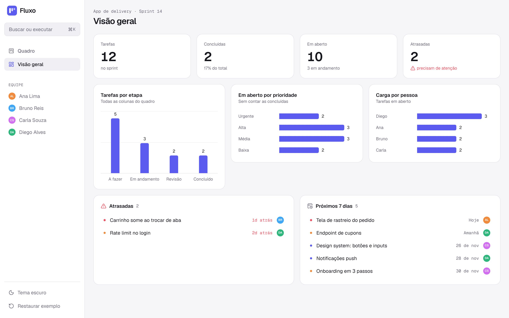

# Fluxo

[](https://github.com/nathangrazo/fluxo-kanban/actions/workflows/ci.yml)

Kanban-style task manager built to practice drag and drop, global state, and micro-interactions. Runs entirely in the browser and persists to `localStorage`.


| Overview | Edit drawer (dark theme) | Command palette |
| :---: | :---: | :---: |
|  |  |  |

## Features

- 4-column board with **drag and drop** across and within columns (mouse, touch, and keyboard)
- Side drawer to edit title, status, priority, due date, assignee, labels, description, and checklist
- Confetti when a task is dragged to "Done" and an "Undo" toast when deleting
- Filters by text, priority, label, and assignee
- **Command palette** (`Ctrl/⌘ + K`) to search tasks and trigger actions
- Shortcuts: `N` creates a task, `/` focuses search, `Esc` closes panels
- **Overview** with KPIs, tasks by stage, by priority, workload per person, overdue, and upcoming
- Light/dark theme without flash on load
- Responsive layout (sidebar turns into a drawer on mobile)

## Stack

React 19, TypeScript, Vite, Tailwind CSS 4, [dnd-kit](https://dndkit.com), Zustand, Motion, and Vitest + Testing Library.

## Decisions

**Normalized state.** The store keeps `tasks` (a `Record` keyed by id) and `order` (an array of ids per column). Moving a card only removes an id from one array and inserts it into another, without copying objects.

**Drag and drop with active filters.** When a filter is active, a column shows fewer cards than it actually contains. Computing the target index from the visible list would drop the card in the wrong slot, so `BoardView` always calculates indices against the full column order.

**dnd-kit and Motion on the same card.** Both try to control `transform`. dnd-kit owns the outer wrapper while Motion only animates entrance on the inner element.

**No react-router.** There are only two screens, so a hook using `useSyncExternalStore` over `location.hash` was enough (`useHashRoute.ts`).

**Dates as `YYYY-MM-DD`.** Due dates have no time component. Storing them as local strings avoids the classic timezone bug where `new Date("2026-03-10")` becomes March 9 in Brazil.

**Charts without a charting library.** Since they are single-series bar charts, they are built with divs and Motion. Each chart includes hover tooltips and a hidden `<table>` with the same data for screen readers.

## Running locally

```bash
npm install
npm run dev
```

| Script | |
| :--- | :--- |
| `npm run dev` | development server |
| `npm test` | tests (store, selectors, and column component) |
| `npm run lint` | ESLint |
| `npm run build` | type-check + build |

The CI workflow runs lint, tests, and build, and deploys to GitHub Pages (enable it under **Settings → Pages → Source: GitHub Actions**).

## Structure

```text
src/
├── components/   # card, column, drawer, command palette, charts, sidebar…
├── views/        # BoardView and OverviewView
├── store/        # board (persisted) and ui (filters, selection, theme)
├── lib/          # selectors and date helpers
├── hooks/        # hash routing, theme, today's date
└── data/seed.ts  # sample tasks
```
