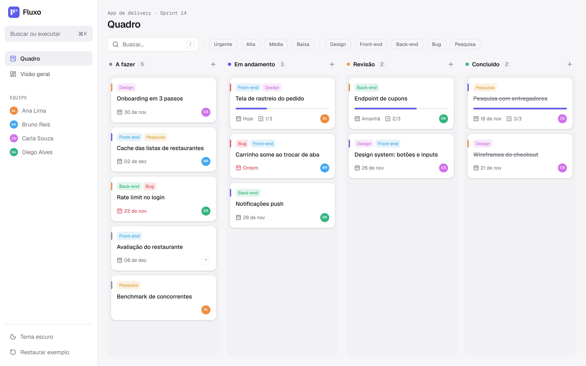
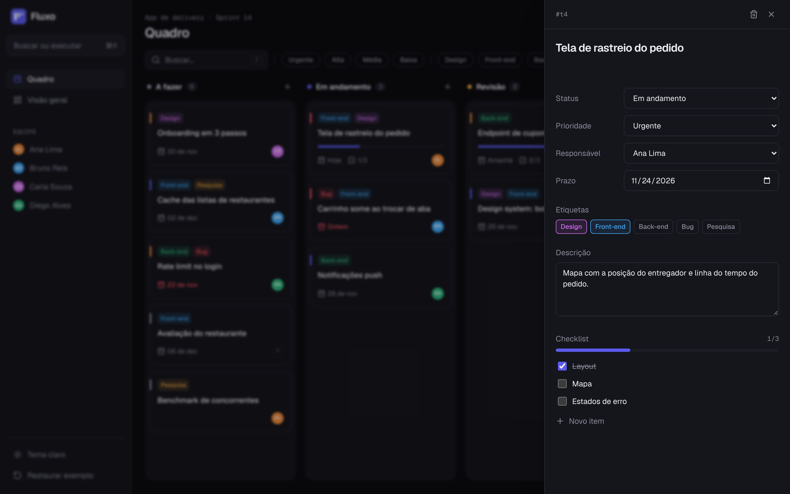

# Fluxo

[](https://github.com/nathangrazo/rep3/actions/workflows/ci.yml)

Gerenciador de tarefas estilo kanban, feito pra estudar drag and drop, estado global e microinterações. Roda inteiro no navegador e salva no `localStorage`.



| Visão geral | Edição (tema escuro) | Paleta de comandos |
| :---: | :---: | :---: |
|  |  |  |

## Funcionalidades

- Quadro com 4 colunas e **drag and drop** entre e dentro delas (mouse, toque e teclado)
- Painel lateral pra editar título, status, prioridade, prazo, responsável, etiquetas, descrição e checklist
- Confete quando uma tarefa é arrastada pra "Concluído" e "Desfazer" ao excluir
- Filtros por texto, prioridade, etiqueta e pessoa
- **Paleta de comandos** (`Ctrl/⌘ + K`) pra buscar tarefas e executar ações
- Atalhos: `N` cria tarefa, `/` foca a busca, `Esc` fecha painéis
- **Visão geral** com KPIs, tarefas por etapa, por prioridade, carga por pessoa, atrasadas e próximas
- Tema claro/escuro sem "piscar" no carregamento
- Layout responsivo (sidebar vira drawer no celular)

## Stack

React 19, TypeScript, Vite, Tailwind CSS 4, [dnd-kit](https://dndkit.com), Zustand, Motion e Vitest + Testing Library.

## Decisões

**Estado normalizado.** A store guarda `tasks` (um `Record` por id) e `order` (um array de ids por coluna). Mover um card é só tirar o id de um array e colocar em outro, sem copiar objetos.

**Drag and drop com filtro ativo.** Com filtro, a coluna mostra menos cards do que existem. Se o índice de destino fosse calculado na lista visível, o card cairia no lugar errado. Por isso o `BoardView` calcula o índice sempre na ordem completa da coluna.

**dnd-kit e Motion no mesmo card.** Os dois querem controlar o `transform`. O dnd-kit fica no elemento de fora e o Motion só anima a entrada no elemento de dentro.

**Sem react-router.** São só duas telas, então um hook com `useSyncExternalStore` lendo o `location.hash` resolveu (`useHashRoute.ts`).

**Datas como `YYYY-MM-DD`.** Prazos são datas sem horário. Guardar como string local evita o clássico bug de fuso em que `new Date("2026-03-10")` vira dia 9 no Brasil.

**Gráficos sem biblioteca.** São barras de uma série só, então montei com divs e Motion. Cada gráfico tem tooltip no hover e uma `<table>` escondida com os mesmos dados pra leitores de tela.

## Rodando

```bash
npm install
npm run dev
```

| Script | |
| :--- | :--- |
| `npm run dev` | servidor de desenvolvimento |
| `npm test` | testes (store, seletores e componente de coluna) |
| `npm run lint` | ESLint |
| `npm run build` | type-check + build |

O workflow de CI roda lint, testes e build e publica no GitHub Pages (ative em **Settings → Pages → Source: GitHub Actions**).

## Estrutura

```text
src/
├── components/   # card, coluna, painel, paleta, gráficos, sidebar…
├── views/        # BoardView e OverviewView
├── store/        # board (persistida) e ui (filtros, seleção, tema)
├── lib/          # seletores e helpers de data
├── hooks/        # rota por hash, tema, data de hoje
└── data/seed.ts  # tarefas de exemplo
```
